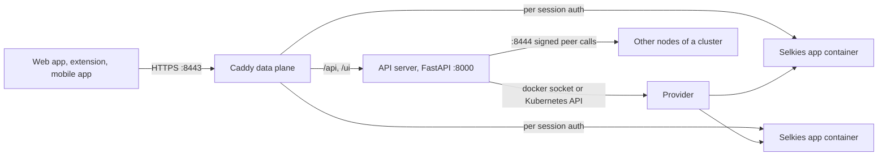

# SealSkin

**Repository:** [selkies-project/sealskin](https://github.com/selkies-project/sealskin) · **Server image:** [linuxserver/docker-sealskin](https://github.com/linuxserver/docker-sealskin) · **Site:** [sealskin.app](https://sealskin.app) · **Docs:** [sealskin.selkies.io](https://sealskin.selkies.io)

SealSkin is the orchestration layer of the platform: a self hosted server that manages users and launches Selkies containers on demand, with a web app, a browser extension, and mobile apps as clients. It is two things at once:

1. **A turnkey VDI platform.** Install the server, open it in a browser or install the extension or mobile app, and you have multi user, on demand, GPU aware application streaming with sign in, file management, collaboration, and clustering built in.
2. **A reference implementation.** If you want to build your own VDI product, kiosk fleet, or internal tool on the Selkies images, SealSkin's source shows exactly how to launch, configure, proxy, secure, and reap these containers correctly. Every trick it uses is documented below, and its `server/app/collaboration.py` is the reference driver of Selkies' secure mode.

The philosophy: **the browser is your operating system.** Click a link, download a file, or open an app and the action lands in an isolated container on your server. Suspicious files never touch your device, heavyweight apps run on server hardware, and sessions are ephemeral by default.

## Architecture

- **Control plane:** a Python FastAPI server on port 8000. Handles sign in, the key based handshake, app and user management, session orchestration, files, shares, and the collaboration WebSocket.
- **Data plane:** a bundled Caddy instance on port 8443 with your certificate. It serves the web app, forwards the API, and proxies every live session path to the right container after asking the API server whether the request may pass. Containers are never published on a host port; only Caddy reaches them.
- **Providers:** container launching is behind a provider abstraction with two implementations, Docker through the socket and Kubernetes, where every session is a pod in the server's own namespace.
- **Nodes:** one server is a cluster of one. Several servers sharing an object store become nodes of the same cluster, calling each other over a signed peer listener on port 8444.

## Clients and sign in

SealSkin takes three kinds of client, and no passwords anywhere:

| Client | Who the user is | Reaches |
| --- | --- | --- |
| **Web app** at `https://<server>:8443/` | A cookie from the root key, an OpenID Connect or SAML identity provider, or a reverse proxy that signs users in through forward auth (Authelia, Authentik, Keycloak, oauth2-proxy, Pocket ID, Tinyauth) | Every node of a cluster |
| **Extension and mobile app** with an application key | A per device key the user made in the web app, shown as text or a QR code, which an administrator can expire, scope, or revoke | Every node of a cluster |
| **Extension and mobile app** with a key file | An RSA key pair, the client signing a short lived JWT for every request over an end to end encrypted API | The one server the file names |

The first start writes two files for the built in `admin` account: `/config/admin.json`, the key file of the companion apps, and `/config/root_key`, the root key that signs the web app in. Groups from the identity provider make administrators and set limits, and a new user in no group is held until an administrator approves them. Key file sign in stays on under `SEALSKIN_LEGACY_AUTH` for existing deployments and can be switched off once the provider is in place.

The web app installs as a PWA, and every application has a pinned address, `/app/<app id>/`, that attaches to its running session or launches one, so a bookmark or a home screen icon lands straight in a desktop.

## How it launches Selkies containers

This is the part to study if you are building your own platform. For each session SealSkin:

1. Generates a session UUID and random `CUSTOM_USER` and `PASSWORD` credentials (a fresh pair per session).
2. Injects environment variables: `SUBFOLDER=/<session_id>/` so the container serves under its session path, `PUID`, `PGID`, `PIXELFLUX_WAYLAND`, `LC_ALL` for the user's language, and `DRINODE` plus `DRI_NODE` when a GPU is assigned.
3. Applies the app template: an admin defined bundle of the standard Selkies environment variables (UI lockdown, hardening, encoders, start policies, watermarks, the connection indicator, 10-bit video, the print spool, the Computer Use token, and so on), plus `DOCKER_*` pseudo variables that translate into Docker options (privileged, devices, memory limits, network mode). The variables the editor offers are declared in the server's `template_schema.yml`, which mirrors what the baseimage and Selkies read, with the defaults the container effectively runs with.
4. Mounts the home directory: a persistent per user home under `/storage/<username>/<home>`, or an ephemeral directory that is deleted when the session ends. A shared files mount lands at `/config/Desktop/files`, and any PRoot Apps catalogs assigned to the user are mounted read only and named through `PA_REPO_FOLDER`.
5. Writes the app's **autostart script** into the mounted home before boot (`.config/labwc/autostart` for Wayland), which is how "open this URL" and "open this file" work: the script consumes `SEALSKIN_URL` or `SEALSKIN_FILE` variables. Scripts come from the [apps registry](sealskin-apps.md).
6. Starts the container with no published ports on the server's Docker network (or as a pod), waits for the web interface to answer, then hands the client a session URL through the Caddy proxy.
7. On session end, stops the container (containers run with auto remove) and deletes ephemeral storage.

For a web sign in, SealSkin serves the Selkies web client itself, taken out of each image after it is pulled, so sessions live at `/<session id>/` on the web app's own origin: one certificate, permissions granted once, no wildcard DNS, and no code from the image running next to the sign in cookie. The container then answers only the session's API. `SEALSKIN_SESSION_ISOLATION` keeps every session on a name of its own instead, for images you do not trust.

GPU allocation is automatic: the server detects render nodes and drivers at startup, users with GPU permission pick a device at launch, Nvidia cards get the runtime and device requests wired up (the NVIDIA Container Toolkit 1.20.1 or newer), Intel and AMD get the DRI device mapped. An app's `nvidia_support` and `dri3_support` flags in the registry gate what the launcher offers.

## Features beyond launching

- **Collaboration rooms:** launch a session in room mode and invite participants with links, full control, read only, or gamepad player slots, with A/V chat signalling and up to four physical gamepads passed through, one slot per controller. Built on Selkies' secure mode: SealSkin provisions the token table through `/api/tokens` and opens each participant's page with its token in the URL fragment, where no server log or Referer sees it.
- **Clusters:** servers share users, groups, applications, templates, and settings through an object store, an S3 bucket or the built in file store, with pools of nodes, placement of sessions, GPU slots, home directories pinned to a node and moved between them, shared files encrypted under `SEALSKIN_STORE_KEY`, limits that hold across nodes, and an append only audit log. `SEALSKIN_NODE_ROLES` makes a node a frontend, a runtime, or both.
- **Kubernetes:** one manifest installs the server in any namespace you administer, with no cluster scoped objects; every session is a pod beside it, with GPUs, pod templates, resource quotas, and pull secrets honored.
- **VPN exits:** administrators import WireGuard and OpenVPN profiles; a user picks one at launch and the session leaves through that tunnel and nothing else, with a gateway per endpoint on Docker and a hub per endpoint on Kubernetes. The application image knows nothing about it.
- **Registries, mirrors, and proxies:** private registries through a Docker `config.json` on each node (`SEALSKIN_REGISTRY_AUTH_PATH`), internal hosts through a netrc file (`SEALSKIN_NETRC_PATH`), `SEALSKIN_IMAGE_MIRRORS` for every pull, and `HTTPS_PROXY` with `SSL_CERT_FILE` for the server's own fetches. A deployment without internet access runs on these alone.
- **File manager:** browse, upload, and download files in your server side homes, with chunked transfers for large files, and password protectable, expiring public download links.
- **App Lab (meta apps):** launch a base app in customize mode, install software and tweak settings interactively, then commit the home directory as a golden template. New "meta apps" launch from copies of that template, no Docker knowledge required.
- **App templates:** reusable environment variable bundles for hardening and UI lockdown, applied per app from the admin UI. A user with the right permission edits templates short of the `DOCKER_*` settings and the identity variables, which stay an administrator's.
- **PRoot Apps catalogs:** catalogs of portable applications assigned to users and groups, fetched on every node and mounted into sessions.
- **Branding:** a name, logo, accent, wallpaper, home links, and the store links of the companion apps, set from the dashboard with a live preview.
- **Download interception:** the extension can intercept your next browser download and reroute the file into an isolated container instead of your disk.
- **Internationalization:** the client is localized in 18 languages, and sessions launch with the user's locale via `LC_ALL`.

## Clients

- **Web app:** served by the server at `/`, the launcher, the file manager, and the admin pages, with nothing to install.
- **Browser extension** ([Chrome](https://chromewebstore.google.com/detail/sealskin-isolation/lclgfmnljgacfdpmmmjmfpdelndbbfhk), [Firefox](https://addons.mozilla.org/en-US/firefox/addon/sealskin-isolation/)): a thin shell around the served UI that adds the privileged pieces: context menu entries (open link isolated, open file isolated, send media, search selection), download interception, and the E2EE session for key files.
- **Mobile apps** ([iOS](https://apps.apple.com/us/app/sealskin/id6758210210), [Android](https://play.google.com/store/apps/details?id=io.linuxserver.sealskin)): Capacitor shells wrapping the same client code, with native file open and a QR scanner for application keys. Sessions open in the system browser for full performance.
- Best experience is on desktop Chromium family browsers. Firefox works with some performance trade offs.

## Deployment notes

- The supported deployment is the LinuxServer.io server image from [linuxserver/docker-sealskin](https://github.com/linuxserver/docker-sealskin), whose installer script also obtains a certificate. The server needs the Docker socket (or a Kubernetes service account), a `/config` volume, a `/storage` volume for user homes, a TLS certificate and key for the session proxy, and a stable container name, which is also its identity among a cluster's records (`SEALSKIN_NODE_NAME` otherwise).
- Configuration is via `SEALSKIN_*` environment variables, listed in the upstream settings reference: ports, the app store URL, `SEALSKIN_PUID` and `SEALSKIN_PGID` for launched containers, storage paths, the identity provider, the object store, and more.
- It runs behind a reverse proxy as well as directly on the internet: set `SEALSKIN_PUBLIC_URL` and `SEALSKIN_TRUSTED_PROXIES`, and `SEALSKIN_HTTP_PORT` for a proxy that terminates TLS. The upstream docs carry a page per proxy, including SWAG.
- App images update automatically in the background when enabled, and the app store cache refreshes hourly by default.

## Privacy

The clients talk only to the server you configure. No analytics, no tracking, no third parties; every picture a page shows is served by your own server. Full policy in [PRIVACY.md](https://github.com/selkies-project/sealskin/blob/main/PRIVACY.md).
